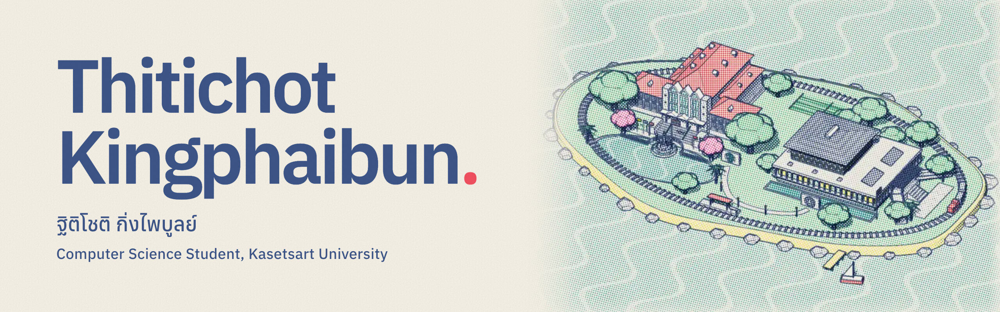

I'm Thitichot (First), a Computer Science student at Kasetsart University in Bangkok. From April to July 2026 I was a
summer intern at the Bank of Thailand Northeastern Region Office in Khon Kaen. I mostly build small tools for the
web, several of them for Thai users.

**[thitichotk.com](https://thitichotk.com)** · [LinkedIn](https://www.linkedin.com/in/thitichotk/) ·
[hello@thitichotk.com](mailto:hello@thitichotk.com)

## Projects

| Project | What it is |
|---|---|
| <a href="https://github.com/thitichotk/instant-voxel"><picture><source media="(prefers-color-scheme: dark)" srcset="https://raw.githubusercontent.com/thitichotk/instant-voxel/main/web/assets/logo-inverse.svg"></picture></a> | Turns 3D models and images into voxel art in the browser, ready to touch up and export for MagicaVoxel, Minecraft or a 3D printer. [instantvoxel.thitichotk.com](https://instantvoxel.thitichotk.com) |
| <a href="https://github.com/thitichotk/money-math"><picture><source media="(prefers-color-scheme: dark)" srcset="https://raw.githubusercontent.com/thitichotk/money-math/main/public/logo-inverse.svg"></picture></a> | Thai loan, savings and deposit calculators that follow Thai banks' rules, written as a sentence and printed like a passbook. [moneymath.thitichotk.com](https://moneymath.thitichotk.com) |
| <a href="https://github.com/thitichotk/loose-notes"><picture><source media="(prefers-color-scheme: dark)" srcset="https://raw.githubusercontent.com/thitichotk/loose-notes/main/assets/logo-inverse.svg"></picture></a> | Pulls the audio, PDFs and images out of `.goodnotes` files, privately in your browser. [loosenotes.thitichotk.com](https://loosenotes.thitichotk.com) |
| <a href="https://github.com/thitichotk/sharp-shooter"><picture><source media="(prefers-color-scheme: dark)" srcset="https://raw.githubusercontent.com/thitichotk/sharp-shooter/main/assets/logo-inverse.svg"></picture></a> | A turn-based WebAR shooter played with printed cards and a phone camera. [sharpshooter.thitichotk.com](https://sharpshooter.thitichotk.com) |

## Bank of Thailand internship

| Project | What it is |
|---|---|
| **[Thai&#8209;Weather](https://github.com/thitichotk/thai-weather)** | Charts daily observations from 127 Thai weather stations next to NOAA's Oceanic Niño Index (Thai interface). [thaiweather.streamlit.app](https://thaiweather.streamlit.app) |
| **[Flat&#8209;Flipbook](https://github.com/thitichotk/flat-flipbook)** | Turns an AnyFlip flipbook into one PDF, for documents whose owner allows downloading (Thai interface). [flatflipbook.streamlit.app](https://flatflipbook.streamlit.app) |

Built with TypeScript and JavaScript for the web apps, Python and Streamlit for the internship apps, C++ compiled to
WebAssembly in Instant-Voxel, and Java at university.
